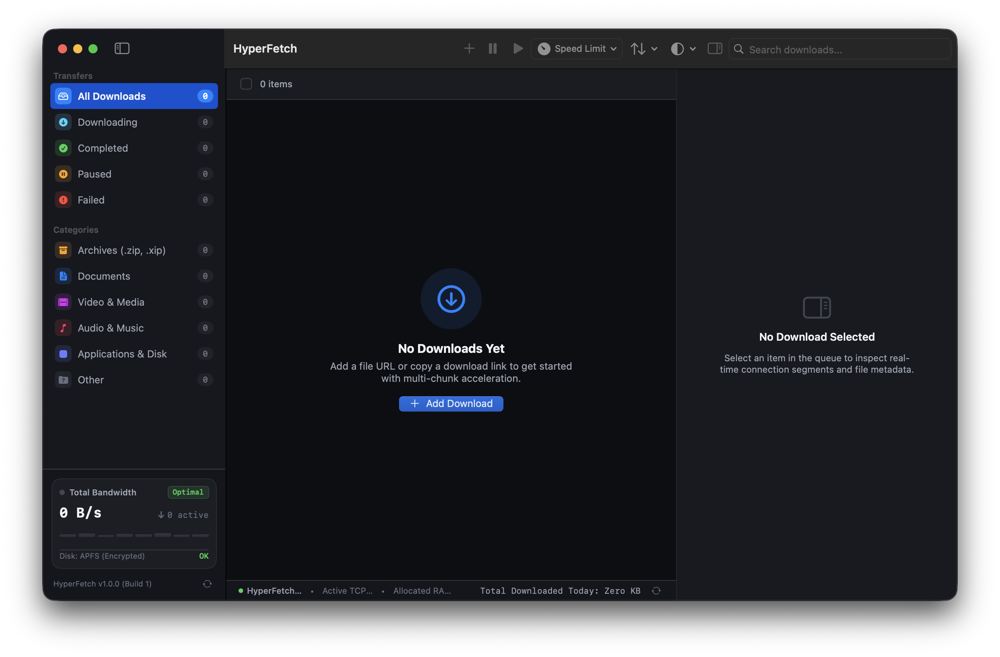

# ⚡ HyperFetch

<p align="center">
  
</p>

<p align="center">
  <strong>Native High-Speed Multi-Chunk Download Manager for Windows & macOS</strong><br>
  <em>The best lightweight, high-speed native download manager for Windows 10/11 & macOS Sonoma/Sequoia.</em>
</p>

<p align="center">
  <a href="https://github.com/consultanything-tech/hyperfetch-app/releases/tag/v1.1.0"></a>
  <a href="https://www.microsoft.com/windows/"></a>
  <a href="https://www.apple.com/macos/"></a>
  <a href="https://rust-lang.org"></a>
  <a href="https://swift.org"></a>
  <a href="LICENSE"></a>
</p>

---

### 🌐 Live Interactive Demo
Try the interactive web showcase and simulator in your browser:  
👉 **[https://consultanything-tech.github.io/hyperfetch-app/](https://consultanything-tech.github.io/hyperfetch-app/)**

---

## ⚡ 1-Line Terminal Quick Install (macOS)

Run this single command in Terminal to download, verify, and launch HyperFetch in `/Applications`:

```bash
curl -sSL https://raw.githubusercontent.com/consultanything-tech/hyperfetch-app/main/install.sh | bash
```

---

## 📦 Direct Downloads (v1.1.0)

| Package | Format | Compatibility | Link |
| :--- | :--- | :--- | :--- |
| **HyperFetch Windows Installer** | `.exe` | Windows 10/11 (64-bit) | [**Download HyperFetch-Windows-x64-Setup.exe**](https://github.com/consultanything-tech/hyperfetch-app/releases/download/v1.1.0/HyperFetch-Windows-x64-Setup.exe) |
| **HyperFetch Disk Image** | `.dmg` | macOS 14.0+ (Apple Silicon & Intel) | [**Download HyperFetch.dmg**](https://github.com/consultanything-tech/hyperfetch-app/releases/download/v1.1.0/HyperFetch.dmg) |
| **HyperFetch Portable Archive** | `.zip` | macOS 14.0+ (Apple Silicon & Intel) | [**Download HyperFetch.zip**](https://github.com/consultanything-tech/hyperfetch-app/releases/download/v1.1.0/HyperFetch.zip) |
| **HyperFetch Chrome Extension** | `.zip` | Chromium Browsers (Chrome, Edge, Brave, Arc) | [**Download HyperFetch_Chrome_Extension.zip**](https://github.com/consultanything-tech/hyperfetch-app/releases/download/v1.1.0/HyperFetch_Chrome_Extension.zip) |

All official releases and checksums are available on the [**GitHub Releases Page**](https://github.com/consultanything-tech/hyperfetch-app/releases).

---

## 📸 Preview

<p align="center">
  
</p>

---

## ✨ Key Features

- **🚀 Accelerated Multi-Chunk Range Streaming**: Splits files into 1 to 16 concurrent HTTP range streams, bypassing ISP/server per-connection bandwidth throttling.
- **⚡ Direct Sparse Zero-Copy I/O**: Pre-allocates disk files atomically and streams incoming segments directly to disk via positional offset streaming. Zero disk fragmentation, zero reassembly lag across Windows and macOS.
- **🎨 Real-Time Chunk Visualizer**: Watch chunks download in parallel through animated, color-coded segmented progress strips inspired by retro download managers and modernized for desktop perfection.
- **🛡️ Bulletproof Browser Interception**: Local DNS-rebinding-protected HTTP bridge (`http://127.0.0.1:31415`) validates Origin, Host, and `Sec-Fetch-Site` to guard against web-based exploit attempts.
- **🚀 Native Desktop Experience**: Windows taskbar progress & system tray; macOS menu bar and background launch management on boot.
- **🎛️ Dual Token-Bucket Rate Limiter**: Effortlessly set custom speed limits (or toggle Unlimited mode) with sub-millisecond precision.
- **📁 Smart Category Routing**: Automatically files completed downloads into `Applications`, `Archives`, `Documents`, `Video`, or `Music` based on MIME type and file extension.
- **🔄 In-App Auto-Updates**: Seamless version checks against GitHub Releases with background downloading and instant in-place self-update.
- **🪶 Featherweight Native Footprint**: ~6 MB binary, idles under 40 MB RAM. Zero Electron, zero Qt, zero trackers, zero promotional ads.

---

## 🧩 Chrome & Chromium Extension Setup

The companion extension intercepts browser downloads and seamlessly passes them to HyperFetch with full cookie, user-agent, and referer preservation.

### Supported Browsers
Works on **Google Chrome**, **Microsoft Edge**, **Brave**, **Arc**, and **Vivaldi**.

### Setup Instructions
1. Download [**HyperFetch_Chrome_Extension.zip**](https://github.com/consultanything-tech/hyperfetch-app/releases/download/v1.1.0/HyperFetch_Chrome_Extension.zip) (or use bundled extension in HyperFetch Settings > Browser).
2. Unzip the downloaded archive.
3. In your browser, open the Extensions page by visiting:
   ```text
   chrome://extensions
   ```
4. Enable **Developer mode** via the toggle switch in the upper-right corner.
5. Click **Load unpacked** in the top-left toolbar.
6. Select the extracted `extensions/chrome` directory (or from this repo).
7. Done! Any initiated download will be routed into HyperFetch automatically.
   > **Pro Tip**: Hold the `Alt` (or `Option ⌥`) key while clicking a download link to temporarily bypass HyperFetch and use the browser's default download mechanism.

---

## 🧭 Safari & System-Wide Integration (macOS)

- **Custom Protocol**: Supports `hyperfetch://<url>` links.
- **macOS Services**: Right-click any link or selected URL in Safari and select **Services → Download with HyperFetch**.
- **Clipboard Auto-Detection**: Simply copy any download URL (`Cmd + C`), and HyperFetch detects and presents the Add Download sheet automatically.

---

## 📊 Technical Comparison

| Feature / Metric | HyperFetch | Free Download Manager | Folx | Browser Default |
| :--- | :--- | :--- | :--- | :--- |
| **Supported Platforms** | **macOS & Windows** | Windows, macOS, Linux | macOS only | All |
| **Binary Size** | **~6 MB** | ~120 MB | ~45 MB | Built-in |
| **Tech Stack** | **Pure Swift 6 & Rust (Tauri 2)** | Qt / C++ Cross-platform | Obj-C / Swift | C++ Chromium/WebKit |
| **Idle Memory** | **< 40 MB** | ~250 MB | ~150 MB | Shared process |
| **Sparse Pre-allocation** | **Yes (Direct offset streaming)** | Temp part files | File merge | Sequential append |
| **Range Visualizer** | **Real-Time (1–16 Chunks)** | Basic progress | Pro only | Single stream |
| **Telemetry / Ads** | **Zero / 100% Clean** | Banner ads / tracking | Pro upsell popups | Telemetry |
| **In-App Auto-Update**| **Instant In-Place** | Yes | Paid upgrade | Browser updates |

---

## 📄 License

HyperFetch is distributed under the [MIT License](LICENSE).
